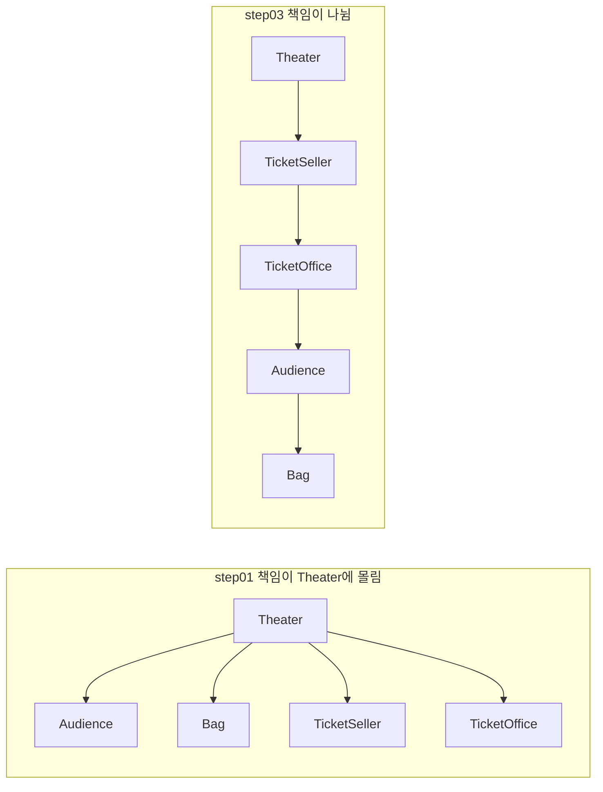

# 오브젝트 1장 - 객체, 설계

## 전체 내용 요약

소극장 예제의 `Theater`에 몰린 책임들을 관람객, 판매원, 가방으로 옮기면서 좋은 설계는 **오늘 동작하면서 내일 쉽게 바꿀 수 있는 코드**이고 그 수단이 캡슐화와 높은 응집도라는 것을 설명한다.

절차지향적에서 객체지향 프로그래밍 방식으로 리팩토링하는 예제로 진행된다.

## 핵심 내용

##### 좋은 모듈의 세 가지 조건

모듈은 클래스, 패키지, 라이브러리처럼 프로그램을 이루는 임의의 요소다.

1. 제대로 동작한다.
2. 생명주기 동안 계속 바뀌므로, 간단한 작업으로 바꿀 수 있어야 한다.
3. 읽는 사람이 쉽게 이해할 수 있어야 한다.

**의존성**

한 객체가 다른 객체를 사용하는 관계이다.

**캡슐화**

객체 내부의 세부 사항을 은닉하고 외부에는 인터페이스만 공개하는 것이다.

**결합도**

서로 다른 모듈 간에 상호 의존하는 정도 또는 연관 관계를 나타낸다.

**응집도**
1. 한 객체가 밀접하게 연관된 일만 하고 연관 없는 일은 다른 객체에 위임하는 정도이다.
2. 하나의 모듈 내부에 존재하는 구성요소들 간의 연관 정도를 나타낸다.
> 결합도와 응집도는 모듈의 독립성을 판단하는 데 핵심 개념이다.

**책임의 이동**

특정 기능을 수행하기 위해 필요한 책임이 하나의 중심 객체나 절차에 집중되어 있던 것에서 각 책임들을 수행하기에 가장 적절한 개별 객체들에게 분산하는 것을 말한다.

**의인화**

가방처럼 현실에서 수동적인 대상도 소프트웨어에서는 능동적이고 자율적인 객체로 설계한다.

## 설계 개선

소극장은 관람객이 가방을 들고 있다는 것도, 판매원이 매표소에서 티켓을 판다는 것도 몰라도 된다. 관람객과 판매원을 자율적인 존재로 만들면 된다.

| 객체 | 책임 |
| --- | --- |
| 소극장 `Theater` | 관람객을 입장시킨다 |
| 판매원 `TicketSeller` | 티켓을 판매한다 |
| 관람객 `Audience` | 티켓을 산다 |

### 설계는 트레이드오프다

매표소의 자율성을 높이자 `TicketOffice`가 `Audience`를 알게 되어 의존성이 하나 늘었다. 기능을 설계하는 방법은 하나가 아니고, 트레이드오프를 따져 골라야 한다.

**참고 글 링크**

조영호님의 설계 트레이드오프 관련 포스팅
[[https://eternity-object.tistory.com/43]]

**느낀점**
1. 지금까지는 설계에 대한 장점을 위주로 비교를 했다. 선택하면 따라오는 단점, 손해와 같은 부분은 크게 신경 쓰지 않았다. 이득이 더 커도 손해를 감당할 수 없으면 고르면 안된다는 시각을 새로 얻었다.
2. 설계에는 정답이 없다. 코드가 놓인 맥락, 요구사항이 바뀌는 방향, 조직 간 관계와 같은 설계 옵션에 따라 상황에 맞는 설계를 고른다.
3. 위 두 방법을 체득하려면 설계 옵션이 바뀌는 환경에서 코드를 직접 유지보수해 본 경험이 필요하다.

## 내 생각

객체, 협력, 책임에 대해 간략하게 코드로 소개해주는 챕터 같았다.

책에는 결합도는 낮게, 응집도는 높게 라는 기준이 정답이라 했지만 무조건 따르면 시야가 좁아질 것 같다. 아직 경험은 없지만 실제 코드에서는 데이터와 프로세스를 한 모듈에 넣을 때와 나눌 때를 비교해 고르는 것이 맞는 거 같다.

## 읽으면서 궁금했던 것

**Q1. `Audience`, `Ticket` 같은 작은 클래스도 모듈인가?**

> 책에선 모듈을 크기와 상관없이 클래스, 패키지, 라이브러리처럼 프로그램을 이루는 임의의 요소로 정의한다. 모듈은 고정된 크기가 아닌 어느 높이에서 보느냐에 따라 달라지는 단위인 거 같다.

**Q2. 항상 의존성을 최대한 줄이는 것이 맞는가? 서로를 전혀 모르고 협력할 수 있는 방법은 존재할까?**

> 전혀 모르고 협럭할 수는 없고 메시지를 보내려면 적어도 상대가 그 메시지를 받는다는 것은 알아야 한다. 책에서도 의존성을 완전히 없애는 것이 아닌 최소한의 의존성만 남기라고 한다.

- 의존성을 줄이는 것이 늘 맞는 방향인가? 의존성이 전혀 없으면서 바꾸기 쉬운 코드가 존재하는가? 객체들이 협력하는데 서로를 전혀 모르는 것이 가능한가?
- 데이터와 프로세스를 한 모듈에 넣을 때와 넣지 않을 때의 트레이드오프는 실제 코드에서 어떻게 비교하나?

**Q3. 데이터와 프로세스를 함께 둘 때와 나눌 때를 실제 코드에서 비교하는 방법은?**

> 아직 잘 모르겠습니다..
