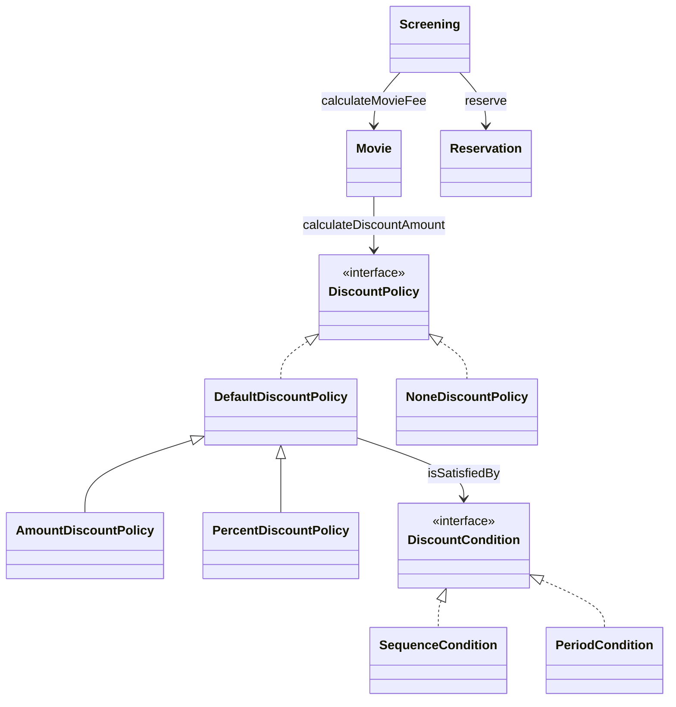

# 오브젝트 2장 - 객체지향 프로그래밍

## 전체 내용 요약

영화 예매 시스템의 할인 요금 계산을 예제로, 클래스보다 **협력하는 객체**를 먼저 떠올리고, 다형성과 추상화로 바꾸기 쉬운 설계를 만들며, 재사용은 상속보다 합성이 유연하다는 것을 보여 준다.

## 요구사항

### 용어 구분

| 용어 | 뜻 | 예 |
| --- | --- | --- |
| 영화 | 영화의 기본 정보 | 제목, 상영 시간, 가격 |
| 상영 | 관객이 실제로 영화를 보는 사건 | 상영 일자, 시작 시간, 순번 |

사용자가 실제로 예매하는 대상은 영화가 아니라 **상영**이다.

### 할인 조건

| 종류 | 기준 | 예 |
| --- | --- | --- |
| 순번 조건 | 상영 순번 | 매일 10번째 상영 |
| 기간 조건 | 요일 + 시작 시간 + 종료 시간 | 목요일 18시~21시 상영 |

- 영화 하나에 할인 조건을 **여러 개** 둘 수 있다.
- 조건을 만족하면 **할인 정책**이 적용된다.

### 할인 정책

| 종류 | 방식 |
| --- | --- |
| 금액 할인 정책 | 예매 요금에서 일정 금액을 뺀다 |
| 비율 할인 정책 | 정가에서 일정 비율을 뺀다 |

- 영화 하나에 할인 정책은 **하나만** 둘 수 있고, 두지 않아도 된다.
- 할인 정책이 없으면 기본 요금으로 판매한다.
- 할인은 **인당** 적용된다.

### 예시: 아바타

| 항목 | 내용 |
| --- | --- |
| 기본 요금 | 1인 10,000원 |
| 할인 조건 | 조조, 10회 상영(순번) / 월 10~12시, 목 18~21시(기간) |
| 할인 정책 | 800원 금액 할인 |
| 예매 | 2019-12-26(목) 7회 18시 상영, 2명 |

| 계산 | 금액 |
| --- | --- |
| 정가 | 10,000 × 2 = 20,000원 |
| 할인 | 800 × 2 = 1,600원 (목 18~21시 기간 조건 만족) |
| **결제 금액** | **18,400원** |


## 핵심 내용

### 협력 구조



### 객체지향적으로 생각하기

1. 클래스는 객체를 추상화한 것이다. 클래스보다 **어떤 객체가 어떤 상태와 행동을 가지는지**를 먼저 정한다.
2. 객체를 독립된 존재가 아니라 **협력하는 공동체의 일원**으로 본다. 윤곽이 잡히면 공통된 객체들을 타입으로 묶고, 타입으로 클래스를 만든다.

**도메인**은 사용자가 문제를 풀려고 프로그램을 쓰는 분야다. 도메인의 개념과 관계를 따라 객체와 클래스를 구성한다.

### 경계, 자율성, 메시지

- 클래스의 안과 밖을 나눠야 객체의 자율성이 보장된다. 속성은 `private`, 상태 변경은 공개 메서드로만 한다.
- 객체는 상태를 숨기고 행동만 공개한다. 다른 객체에 **메시지**로 요청하고, 받은 객체는 자기만의 **메서드**로 처리한다. `Screening`은 `Movie`에 요금 계산 메시지를 보낼 뿐, 어떤 메서드가 실행되는지는 모른다.

| 역할 | 목표 |
| --- | --- |
| 클래스 작성자 | 필요한 부분만 공개하고 나머지는 숨긴다(**구현 은닉**). 그래야 내부를 마음대로 바꿀 수 있다 |
| 클라이언트 프로그래머 | 공개된 클래스들을 엮어 애플리케이션을 빠르고 안정적으로 만든다 |

### 다형성과 추상화

- 코드의 의존성(컴파일 시간)과 실행 시점의 의존성이 다를 수 있다.
- **다형성**은 같은 메시지를 받았을 때 객체의 타입에 따라 다르게 응답하는 것을 말한다. 다형적인 협력에 참여하는 객체는 모두 같은 메시지를 이해해야 한다.
- 유연성을 키우면 재사용성 및 확장이 쉬워지지만 코드의 가독성이 떨어진다.
- 추상화를 쓰면 세부 사항을 빼고 상위 정책만 표현할 수 있다.

| | 이름 | 매개변수 | 설명 |
| --- | --- | --- | --- |
| 오버라이딩 | 부모 메서드와 같음 | 같음 | 자식 클래스가 구현만 재정의한다 |
| 오버로딩 | 같음 | 다름 | 같은 이름으로 다른 매개변수를 받는다. 한 클래스 안에서도 쓴다 |

### 상속과 합성

#### 템플릿 메서드 패턴

부모 클래스가 알고리즘의 **흐름**을 구현하고 중간에 필요한 처리만 **추상 메서드**로 남겨 자식 클래스에 맡기는 패턴이다.

예제에선 `DefaultDiscountPolicy`가 할인 조건을 하나씩 검사해서, 하나라도 맞으면 할인 금액을 구한다 는 흐름만 가지고 **얼마를 할인할지**만 자식에게 맡긴다.

```java
public abstract class DefaultDiscountPolicy implements DiscountPolicy {
    private List<DiscountCondition> conditions;

    // 템플릿 메서드: 흐름은 부모가 정한다
    public Money calculateDiscountAmount(Screening screening) {
        for (DiscountCondition each : conditions) {
            if (each.isSatisfiedBy(screening)) {
                return getDiscountAmount(screening);   // 맡기는 메서드
            }
        }
        return Money.ZERO;
    }

    // 자식이 구현해야 할 메서드
    abstract protected Money getDiscountAmount(Screening screening);
}
```

```java
public class AmountDiscountPolicy extends DefaultDiscountPolicy {
    private Money discountMoney;

    @Override
    protected Money getDiscountAmount(Screening screening) {
        return discountMoney;                            // 정해진 금액만큼 할인
    }
}

public class PercentDiscountPolicy extends DefaultDiscountPolicy {
    private double percent;

    @Override
    protected Money getDiscountAmount(Screening screening) {
        return screening.getMovieFee().times(percent);   // 요금의 일정 비율만큼 할인
    }
}
```

두 자식 클래스는 조건 검사 코드를 한 줄도 갖고 있지 않다. 부모와 **다른 부분만** 구현했다.

> **차이에 의한 프로그래밍**
> 부모 클래스를 기반으로 삼아 추가되거나 변경되는 부분만 새로 작성하여 자식 클래스를 쉽고 빠르게 만드는 방법이다.

#### 인터페이스와 추상 클래스를 둘 다 쓰는 이유

할인 정책 쪽에는 `DiscountPolicy`(인터페이스)와 `DefaultDiscountPolicy`(추상 클래스)가 함께 있다.

|                                  | 역할                            | 목적                                       |
| -------------------------------- | ----------------------------- | ---------------------------------------- |
| `DiscountPolicy` (인터페이스)         | **약속**: "상영을 주면 할인 금액을 알려 준다" | `Movie`가 모든 정책을 같은 방식으로 부를 수 있게 한다 - 다형성 |
| `DefaultDiscountPolicy` (추상 클래스) | **공통 뼈대**: 조건을 검사하는 흐름        | 조건이 있는 정책들이 같은 코드를 반복하지 않게 한다 - 재사용      |

`NoneDiscountPolicy`는 조건이 필요 없어서 인터페이스를 사용한다.

```java
public class NoneDiscountPolicy implements DiscountPolicy {
    @Override
    public Money calculateDiscountAmount(Screening screening) {
        return Money.ZERO;
    }
}
```

여기서 문득 궁금해졌다. 꼭 둘 다 써야 할까? `DiscountPolicy`를 아래 세 가지로 만들었을 때의 트레이드오프를 비교해 봤다.

1. **추상 클래스만**으로 구현했을 때
2. **인터페이스만**으로 구현했을 때
3. **인터페이스 + 추상 클래스**로 구현했을 때

| 구조                 | 장점                              | 문제                                                                                        |
| ------------------ | ------------------------------- | ----------------------------------------------------------------------------------------- |
| 추상 클래스만            | 조건 검사 반복문을 부모에 한 번만 쓴다          | 할인 없음 정책도 조건 검사 흐름을 물려받는다. 조건이 없어 반복문이 돌지 않아 자식의 `getDiscountAmount()` 메서드는 한 번도 불리지 않는다. |
| 인터페이스만             | 할인 없음 정책은 "항상 0원"만 구현하면 되어 깔끔하다 | 조건이 있는 정책마다 조건 목록과 반복문을 복사한다. 규칙이 바뀌면 모든 정책을 고쳐야 한다                                       |
| **인터페이스 + 추상 클래스** | 위 두 문제를 모두 해결한다                 | 클래스가 하나 늘어나 구조가 조금 복잡해진다 하지만 확장성과 재사용성은 늘어난다.                                             |

**추상 클래스만 쓸 때의 문제는** `NoneDiscountPolicy`의 `getDiscountAmount()`가 0원 대신 100만 원을 반환하거나 예외를 던지게 바꿔도 2명 요금은 똑같이 20,000원이다. 애초에 할인 조건이 없어 반복문을 건너뛰어 부모의 `return Money.ZERO`를 반환해서 생기는 문제다.

버그는 없지만, 자식 코드만 읽으면 이 메서드가 0을 반환해서 할인이 없구나 라고 오해할 수 있다. 자식이 부모의 내부 구현에 몰래 기대고 있다.

**인터페이스만 쓸 때**는 반복문을 공통으로 모을 곳이 없다.

**두 가지를 함께 쓰면?**

**인터페이스는 다형성**을 **추상 클래스는 재사용**을 맡는다.
확정성과 재사용성을 동시에 가진다.

`Movie`는 인터페이스만 알기 때문에 상황에 맞는 정책을 부르기만 하면 된다.

#### 상속과 합성 비교

| | 상속 | 합성 |
| --- | --- | --- |
| 재사용 방식 | 부모의 코드를 물려받는다 | 다른 객체를 인스턴스 변수로 가지고 메시지를 보낸다 |
| 관계가 정해지는 때 | 컴파일 시점 | 실행 중에 바꿀 수 있다 |
| 캡슐화 | 자식이 부모의 구현을 알아야 해서 깨진다 | 인터페이스만 알면 된다 |
| 변경 영향 | 부모가 바뀌면 자식도 바뀐다 | 인터페이스가 그대로면 영향이 적다 |

## 내 생각

- 객체가 공개하는 인터페이스(행동)은 다른 객체가 보내는 메시지의 형식을 정해 둔 것 같다.
- 책이 말하는 인터페이스와 구현은 코드 수준의 `interface`와는 조금 다른 범주 같다.
    - 공개된 메서드 자체를 인터페이스라 부르는 것 같다.
- 인터페이스와 추상 메서드를 같이 써보는 방법의 트레이프오프를 처음 비교해봤다. 클래스가 많아지면 복잡해지지만 그만큼 재사용성과 확장성은 늘어나는 거 같다.

## 궁금한 것

**Q1. 일상에서 말하는 도메인과 소프트웨어의 도메인은 어떻게 다른가? 영화 예매가 도메인인데, DDD로 나누면 user, movie 같은 하위 도메인으로 또 쪼개진다. 이 둘은 어떻게 구분하나?**

> 도메인도 어느 관점에서 보냐에 따라 달라지는 거 같다.
> 서비스 전체를 통 틀어 영화 예매, 서비스를 구성하는 흐름으로 나누면 예매, 할인 등등의 하위 도메인으로 나뉘는 거 보니 어떤 것을 핵심 개념으로 삼을 것인지 판단하는 것이 중요한 것 같다 이게 DDD의 핵심인 거 같기도 하다

**Q2. 다형성이 상속보다 큰 범위인가? 다형성을 이루는 방법이 상속인가?**

> 다형성이 더 큰 개념이고, 상속은 다형성을 만드는 **방법 중 하나**에 속한다.
>
> 다형성의 조건은 인터페이스가 같은 것이다. 상속을 쓰면 자식이 부모의 인터페이스를 물려받으니 조건이 채워진다. 하지만 인터페이스를 구현하는 것만으로도 채울 수 있다.

**Q3. `Movie.changeDiscountPolicy()`는 왜 특별하다고 하나?**

> `Movie`가 할인 정책을 상속받지 않고 **인스턴스 변수로 가지고 있기 때문에**, 실행 중에 정책을 바꿔 끼울 수 있다.
>
> 반대로 `AmountDiscountMovie extends Movie`처럼 상속으로 만들었다면, 부모-자식 관계는 컴파일 시점에 고정되어  정책을 바꾸려면 다른 클래스의 객체를 새로 만들어야 한다.
>
> 전략 패턴인 거 같다.

**Q4. 책에서 말하는 인터페이스와 구현은 코드의 `interface`와 같은가?**

> 더 넓은 뜻으로 쓰인다. 책에선 인터페이스를 객체가 외부로 공개하는 메시지(공개 메서드)의 목록을 말한다. 

