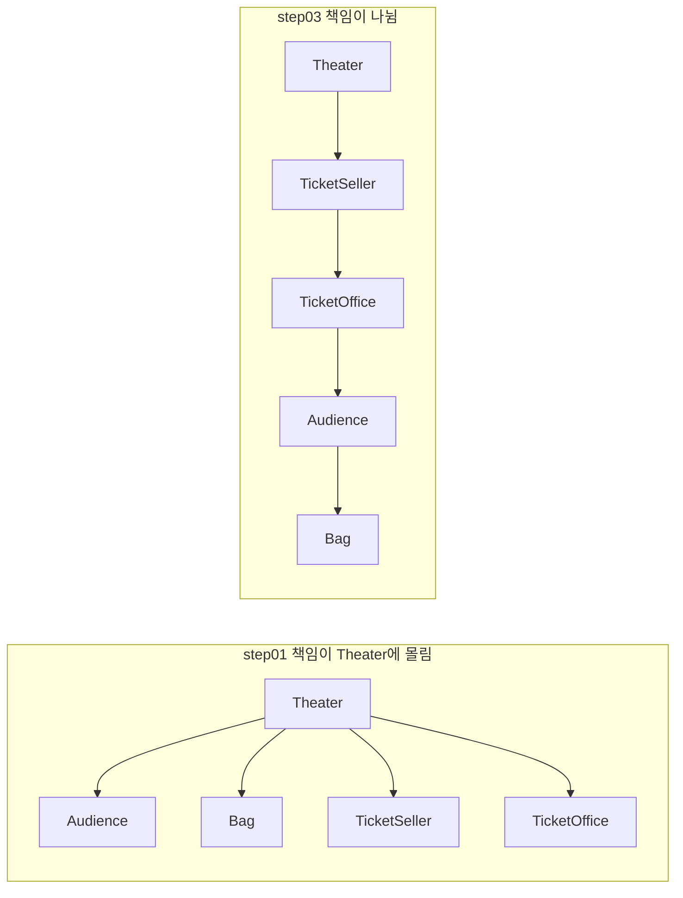
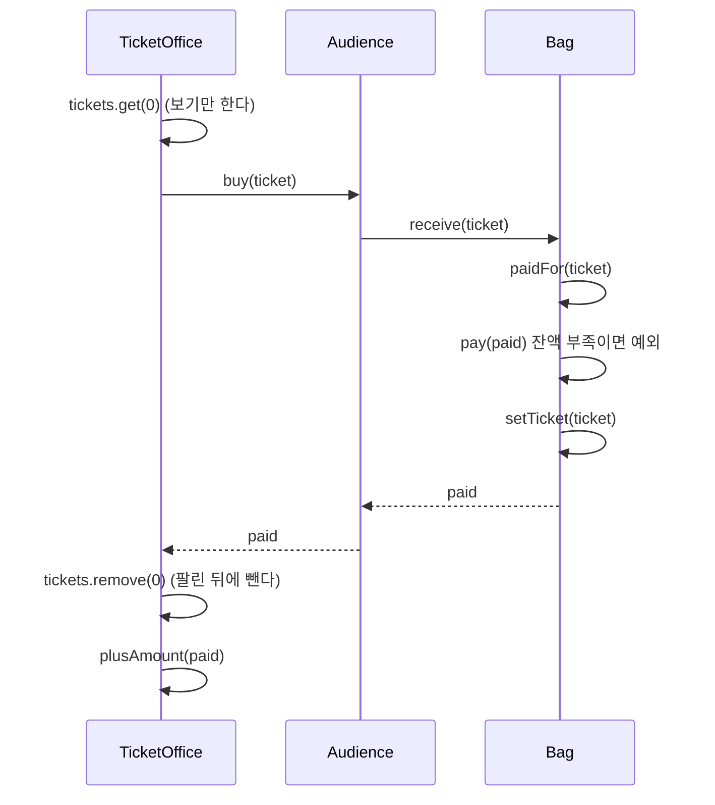

# 오브젝트 1장 - 객체, 설계

## 전체 내용 요약

소극장 예제의 `Theater`에 몰린 책임들을 관람객, 판매원, 가방으로 옮기면서 좋은 설계는 **오늘 동작하면서 내일 쉽게 바꿀 수 있는 코드**이고 그 수단이 캡슐화와 높은 응집도라는 것을 설명한다.

절차지향적에서 객체지향 프로그래밍 방식으로 리팩토링하는 예제로 진행된다.

## 핵심 내용

##### 좋은 모듈의 세 가지 조건

모듈은 클래스, 패키지, 라이브러리처럼 프로그램을 이루는 임의의 요소다.

1. 제대로 동작한다.
2. 생명주기 동안 계속 바뀌므로, 간단한 작업으로 바꿀 수 있어야 한다.
3. 읽는 사람이 쉽게 이해할 수 있어야 한다.

**의존성**

한 객체가 다른 객체를 사용하는 관계이다.

**캡슐화**

객체 내부의 세부 사항을 은닉하고 외부에는 인터페이스만 공개하는 것이다.

**결합도**

서로 다른 모듈 간에 상호 의존하는 정도 또는 연관 관계를 나타낸다.

**응집도**
1. 한 객체가 밀접하게 연관된 일만 하고 연관 없는 일은 다른 객체에 위임하는 정도이다.
2. 하나의 모듈 내부에 존재하는 구성요소들 간의 연관 정도를 나타낸다.
> 결합도와 응집도는 모듈의 독립성을 판단하는 데 핵심 개념이다.


**책임의 이동**

특정 기능을 수행하기 위해 필요한 책임이 하나의 중심 객체나 절차에 집중되어 있던 것에서 각 책임들을 수행하기에 가장 적절한 개별 객체들에게 분산하는 것을 말한다.

**의인화**

가방처럼 현실에서 수동적인 대상도 소프트웨어에서는 능동적이고 자율적인 객체로 설계한다.

## 설계 개선

소극장은 관람객이 가방을 들고 있다는 것도, 판매원이 매표소에서 티켓을 판다는 것도 몰라도 된다. 관람객과 판매원을 자율적인 존재로 만들면 된다.

| 객체 | 책임 |
| --- | --- |
| 소극장 `Theater` | 관람객을 입장시킨다 |
| 판매원 `TicketSeller` | 티켓을 판매한다 |
| 관람객 `Audience` | 티켓을 산다 |



### 설계는 트레이드오프다

매표소의 자율성을 높이자 `TicketOffice`가 `Audience`를 알게 되어 의존성이 하나 늘었다. 기능을 설계하는 방법은 하나가 아니고, 트레이드오프를 따져 골라야 한다.

**참고 글 링크**

조영호님의 설계 트레이드오프 관련 포스팅
[[https://eternity-object.tistory.com/43]]

**느낀점**
1. 지금까지는 설계에 대한 장점을 위주로 비교를 했다. 선택하면 따라오는 단점, 손해와 같은 부분은 크게 신경 쓰지 않았다. 이득이 더 커도 손해를 감당할 수 없으면 고르면 안된다는 시각을 새로 얻었다.
2. 설계에는 정답이 없다. 코드가 놓인 맥락, 요구사항이 바뀌는 방향, 조직 간 관계와 같은 설계 옵션에 따라 상황에 맞는 설계를 고른다.
3. 위 두 방법을 체득하려면 설계 옵션이 바뀌는 환경에서 코드를 직접 유지보수해 본 경험이 필요하다.

## 내 생각

객체, 협력, 책임에 대해 간략하게 코드로 소개해주는 챕터 같았다.

책에는 결합도는 낮게, 응집도는 높게 라는 기준이 정답이라 했지만 무조건 따르면 시야가 좁아질 것 같다. 아직 경험은 없지만 실제 코드에서는 데이터와 프로세스를 한 모듈에 넣을 때와 나눌 때를 비교해 고르는 것이 맞는 거 같다.

## 읽으면서 궁금했던 것

**Q1. `Audience`, `Ticket` 같은 작은 클래스도 모듈인가?**

> 책에선 모듈을 크기와 상관없이 클래스, 패키지, 라이브러리처럼 프로그램을 이루는 임의의 요소로 정의한다. 모듈은 고정된 크기가 아닌 어느 높이에서 보느냐에 따라 달라지는 단위인 거 같다.

**Q2. 항상 의존성을 최대한 줄이는 것이 맞는가? 서로를 전혀 모르고 협력할 수 있는 방법은 존재할까?**

> 전혀 모르고 협럭할 수는 없고 메시지를 보내려면 적어도 상대가 그 메시지를 받는다는 것은 알아야 한다. 책에서도 의존성을 완전히 없애는 것이 아닌 최소한의 의존성만 남기라고 한다.

- 의존성을 줄이는 것이 늘 맞는 방향인가? 의존성이 전혀 없으면서 바꾸기 쉬운 코드가 존재하는가? 객체들이 협력하는데 서로를 전혀 모르는 것이 가능한가?
- 데이터와 프로세스를 한 모듈에 넣을 때와 넣지 않을 때의 트레이드오프는 실제 코드에서 어떻게 비교하나?

**Q3. 데이터와 프로세스를 함께 둘 때와 나눌 때를 실제 코드에서 비교하는 방법은?**

> 아직 잘 모르겠습니다..

#### 코드 리팩토링

step04 코드에 테스트를 붙이면서 보인 것들을 step05에서 고쳤다.

| 변경                           | 분류    |
| ---------------------------- | ----- |
| 티켓 요금을 생성자로 받기               | 리팩토링  |
| `Bag.hold` → `receive` 이름 변경 | 리팩토링  |
| 얼마 낼지 · 내기 · 받기로 단계 분리       | 리팩토링  |
| 잔액이 부족하면 예외                  | 기능 추가 |
| 구매에 실패해도 매표소 티켓 유지           | 버그 수정 |

##### 1. 티켓 요금을 생성자로 받기

테스트 코드를 작성하던 중 티켓의 값이 정해져 있지 않다는 것을 발견했다.
티켓 값을 상수로 고정하지 않은 이유는 티켓 종류가 늘어갈 수 있기 때문에 생성자로 받게 했다.

```java
public Ticket(Long fee) {
    this.fee = fee;
}
```

##### 2. hold → receive, 공개 메서드는 흐름만

티켓을 받는 메서드인데 "가지다"라는 뜻의 `hold`는 잘 어울리지 않아 `receive`로 바꿨다.
기존 `hold`는 초대장 검사, 티켓 받기, 금액 정산이 3가지 일을 하나의 메서드에서 수행했다.

```java
public Long receive(Ticket ticket) {
    Long paid = paidFor(ticket); // 얼마를 낼지
    pay(paid);                   // 잔액 검사 후 지불
    setTicket(ticket);           // 티켓 받기
    return paid;
}

private Long paidFor(Ticket ticket) {
    return hasInvitation() ? 0L : ticket.getFee();
}

private void pay(Long paid) {
    if (amount < paid) {
        throw new IllegalStateException("잔액이 부족합니다.");
    }
    minusAmount(paid);
}
```

메서드는 한 가지 일만 한다 라는 문장을 `객체지향 시스템 디자인 원칙` 책 초반부에서 봤던 것이 기억나서 나눠 보았다.

근데 코드를 리팩토링 하면서 느낀 점은 한 가지 일만 하는 게 좋은 코드라 했는데 결국 리팩토링해도 지불한 금액을 받고 pay() 메서드를 호출하고 티켓을 받고 지불한 금액을 반환 하는 한 가지 흐름 안에 여러 가지 기능이 있는 느낌이다.

##### 3. 테스트가 잡은 버그: 사라지는 티켓

잔액 검사를 넣고 테스트를 쓰다가 버그를 발견했다.

> 티켓이 한 장 남은 매표소에서 5천 원 관람객이 잔액 부족으로 실패한 뒤, 2만 원 관람객이 오면 티켓을 받지 못한다.

```
돈이 부족한 관람객이 실패해도 티켓은 남아 다음 관람객이 입장한다 FAILED
Unexpected exception thrown: java.lang.IndexOutOfBoundsException: Index 0 out of bounds for length 0
```

원인은 매표소에서 티켓을 **먼저 빼고** 관람객에게 팔았기 때문이다.

```java
// 전: 티켓을 먼저 뺀다
plusAmount(audience.buy(getTicket()));   // getTicket() = tickets.remove(0)

// 후: 팔린 뒤에 뺀다
Long paid = audience.buy(tickets.get(0));
tickets.remove(0);
plusAmount(paid);
```

`Bag` 안의 순서만 고쳐서는 부족했다. 실패가 한 단계 바깥인 매표소에 흔적을 남겼고, 매표소도 같은 원칙(검사 먼저, 상태 변경은 나중에)으로 고쳤다.



##### 배운 것
- 엄밀한 트랜잭션은 아니지만 조건 검사, 상태 변경 순서만 지켜도 실패했을 때 상태가 깨지지 않는다.
- 테스트가 없었다면 해당 버그를 잡지 못했다. 다시 한 번 테스트 코드의 중요성을 느꼈다. 캡슐화로 상태가 감춰져 있을수록 테스트로 동작을 확인해야 할 거 같다.