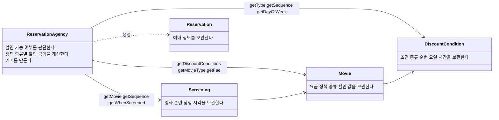
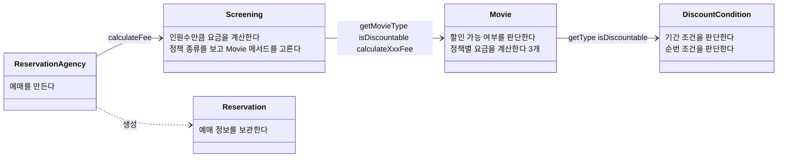

# 오브젝트 4장 - 설계 품질과 트레이드오프

## 전체 내용 요약

영화 예매 시스템을 **데이터 중심**으로 설계해 보고, 캡슐화, 응집도, 결합도라는 세 기준으로 책임 중심 설계와 비교한다.

getter/setter를 없애고 오퍼레이션을 객체 안으로 옮겨도, 메서드 시그니처가 내부 구현을 드러내면 여전히 데이터 중심 설계다. 진짜 캡슐화는 **변할 수 있는 것은 무엇이든 감추는 것**이다.

## 핵심 내용

### 설계 품질을 재는 세 기준

설계는 변경을 위해 존재하고, 변경에는 비용이 든다. 좋은 설계는 **합리적인 비용 안에서 변경을 받아들이는 구조**다. 그 구조를 재는 기준이 아래 세 가지이고, 모두 **변경의 관점**에서 본다.

| 기준  | 뜻                                      | 변경의 관점에서 보면                     |
| --- | -------------------------------------- | ------------------------------- |
| 캡슐화 | 변하기 쉬운 **구현**은 숨기고, 안정적인 **인터페이스**만 공개 | 변경의 여파가 밖으로 번지지 않게 막는다          |
| 응집도 | 모듈 안의 요소들이 하나의 목적을 위해 협력하는 정도          | 하나의 변경에 한 모듈만 바뀌면 높다고 본다        |
| 결합도 | 다른 모듈에 대해 얼마나 많이 알고 있는가                | 한 모듈을 바꿀 때 다른 모듈도 바꿔야 하면 높다고 본다 |

- 응집도와 결합도는 `어느 정도면 높다`는 기준선이 없어 판단하기 애매하다. 그래서 변경이 생겼을 때 `얼마나 많은 곳을 고쳐하는가?` 로 판단하는 것이 중요하다.
- 구현이 아니라 인터페이스에 의존해야 결합도가 낮아진다. (결제 모듈 구현 시 흔히 쓰는 전략패턴을 생각하면 될 거 같다.)
- 변경이 거의 없는 모듈(`String`, `ArrayList` 같은 표준 라이브러리, 성숙한 프레임워크)에는 의존해도 된다.

### 첫 번째 설계 - 데이터 중심 (step01)

이 객체가 가져야 할 데이터는 무엇인가? 를 반복해서 묻는다. `Movie`에 할인 종류(`movieType`)가 생기면, 종류마다 필요한 데이터(`discountAmount`, `discountPercent`)가 따라 붙는다.

모든 클래스는 getter/setter만 가진 데이터 덩어리가 되고, 예매 절차는 `ReservationAgency` 한 곳에서 데이터를 꺼내 처리한다.

```java
// ReservationAgency.reserve() 일부
for (DiscountCondition condition : movie.getDiscountConditions()) {
    if (condition.getType() == DiscountConditionType.PERIOD) {
        discountable = screening.getWhenScreened().getDayOfWeek().equals(condition.getDayOfWeek()) && ...
    } else {
        discountable = condition.getSequence() == screening.getSequence();
    }
}

switch (movie.getMovieType()) {
    case AMOUNT_DISCOUNT:  discountAmount = movie.getDiscountAmount(); break;
    case PERCENT_DISCOUNT: discountAmount = movie.getFee().times(movie.getDiscountPercent()); break;
    case NONE_DISCOUNT:    discountAmount = Money.ZERO; break;
}
```

| 문제     | 원인                                                                                                 |
| ------ | -------------------------------------------------------------------------------------------------- |
| 캡슐화 위반 | 필드가 `private`이어도 getter/setter가 어떤 상태가 있는지 드러내고 외부에서 내부 상태를 제어 가능하게 한다                             |
| 높은 결합도 | `fee`의 타입을 바꾸면 `getFee()`의 반환 타입과 `ReservationAgency`가 함께 바뀐다. 제어 로직이 한 객체에 몰려 모든 데이터 객체와 강하게 결합한다 |
| 낮은 응집도 | 할인 정책, 조건이 추가되는 것을 포함해, 예매와 관련된 거의 모든 변경에서 `ReservationAgency`가 바뀐다                                |

> **추측에 의한 설계** (design-by-guessing strategy)
> 협력을 고민하지 않고 어딘가 쓰이겠지 하며 접근자와 수정자를 다는 설계 방식이다.

> **단일 책임 원칙** (Single Responsibility Principle)
> 클래스는 단 한 가지의 변경 이유만 가져야 한다.

### 두 번째 설계: 자율적인 객체를 향해 (step02)

두 질문을 순서대로 적용해 리팩토링했다.

1. 이 객체가 어떤 데이터를 포함해야 하는가?
2. 이 객체가 그 데이터에 대해 수행할 오퍼레이션은 무엇인가?

setter가 사라지고 객체마다 오퍼레이션이 생겼다. `ReservationAgency.reserve()`는 `screening.calculateFee()` 한 줄로 줄었다.

같은 원리를 사각형 예제로 보면 더 단순하다.

```java
// step01: 밖에서 꺼내서 바꾼다
rectangle.setRight(rectangle.getRight() * multiple);

// step02: 객체가 스스로 바꾼다
public void enlarge(int multiple) {
    right *= multiple;
    bottom *= multiple;
}
```

### 하지만 여전히 데이터 중심이다

```java
// DiscountCondition: 파라미터가 내부 필드를 그대로 드러낸다
public boolean isDiscountable(DayOfWeek dayOfWeek, LocalTime time) { ... }
public boolean isDiscountable(int sequence) { ... }

// Movie: 할인 정책이 세 가지라는 사실을 밖에 알린다
public Money calculateAmountDiscountedFee() { ... }
public Money calculatePercentDiscountedFee() { ... }
public Money calculateNoneDiscountedFee() { ... }
```

| 문제     | 원인                                                            |
| ------ | ------------------------------------------------------------- |
| 캡슐화 위반 | 파라미터와 `getType()`으로 내부 속성을 유추할 수 있다. 정책이 추가, 제거되면 호출하는 쪽도 바뀐다 |
| 높은 결합도 | 할인 조건이 바뀌면 `Movie.isDiscountable()`이 바뀐다                      |
| 낮은 응집도 | 할인 조건 하나가 바뀌어도 `Movie`, `Screening`까지 번진다                     |

> **진정한 캡슐화란?**
> 변경될 수 있는 어떤 것이라도 감추는 것이다.
> 내부 속성을 감추는 **데이터 캡슐화**는 캡슐화의 한 부분일 뿐이다. 속성의 타입이든 할인 정책의 종류든, 내부 구현이 바뀌어 외부 객체가 영향을 받는다면 캡슐화 위반이다.

### CRC 카드로 본 step01 → step02

3장의 CRC 카드로 두 설계를 그려 보면 책임이 어디에 몰렸는지 보인다. 상자 하나가 카드 하나이고, 상자 안은 책임, 화살표는 협력(부르는 메서드)이다.

**step01: 책임이 `ReservationAgency` 하나에 몰렸다**



| 클래스 | 책임 | 협력자 |
| --- | --- | --- |
| `ReservationAgency` | 할인 여부 판단, 할인 금액 계산, 예매 생성 | `Screening`, `Movie`, `DiscountCondition`, `Reservation` |
| `Screening` | (없음) 데이터 보관 | — |
| `Movie` | (없음) 데이터 보관 | — |
| `DiscountCondition` | (없음) 데이터 보관 | — |

`ReservationAgency`만 일하고 나머지는 getter/setter만 가진 데이터 덩어리다. 협력자 칸이 한 카드에만 몰려 있다.

**step02: 책임은 나뉘었지만 협력이 내부를 드러낸다**



| 클래스 | 책임 | 협력자 |
| --- | --- | --- |
| `ReservationAgency` | 예매 생성 | `Screening`, `Reservation` |
| `Screening` | 요금 계산, 정책 종류에 맞는 메서드 선택 | `Movie` |
| `Movie` | 할인 가능 여부 판단, 정책별 요금 계산 | `DiscountCondition` |
| `DiscountCondition` | 기간 조건 판단, 순번 조건 판단 | — |

책임이 각 카드로 흩어졌고 `ReservationAgency`는 한 줄이 됐다. 하지만 화살표에 붙은 메시지를 보면 문제가 남아 있다.

- `Screening → Movie`: `getMovieType()`으로 정책 종류를 묻고, 종류에 맞는 `calculateXxxFee()`를 직접 고른다. `Screening`이 정책이 세 가지라는 사실을 안다.
- `Movie → DiscountCondition`: `getType()`으로 조건 종류를 묻고, 종류에 맞는 `isDiscountable(...)`을 고른다. `Movie`가 조건의 내부 구성을 안다.

CRC 카드에서 책임 칸은 깔끔해졌는데, **협력의 화살표가 "무엇을 해 줘"가 아니라 "너 어떤 종류야?"를 묻고 있다.** 이것이 step02가 여전히 데이터 중심인 이유다. 2장 코드는 같은 자리에서 `calculateDiscountAmount(screening)`, `isSatisfiedBy(screening)`처럼 종류를 묻지 않고 일을 맡긴다.

### 데이터 중심 설계의 근본 문제

1. 너무 이른 시기에 데이터에 관해 결정하도록 강요한다.
2. 협력이라는 문맥 없이 객체를 고립시킨 채 오퍼레이션을 정한다.

올바른 객체지향 설계는 **외부(협력)를 먼저** 고민한다. 협력에 필요한 책임을 정하고 그 책임을 수행할 객체를 정하는 것이 먼저이고, 내부 상태와 그 관리는 부가적인 문제다.

2장 코드와 비교하면 차이가 바로 보인다.

| | 4장 step02 (데이터 중심) | 2장 (책임 중심) |
| --- | --- | --- |
| 할인 조건 | `isDiscountable(DayOfWeek, LocalTime)`, `isDiscountable(int)` | `isSatisfiedBy(Screening)` 하나 |
| 할인 정책 | `Movie`에 정책별 메서드 세 개 | `DiscountPolicy` 인터페이스 뒤에 숨김 |
| 정책이 추가되면 | `Movie`와 호출하는 쪽을 고친다 | 새 클래스 하나를 추가한다 |

## 내 생각

3~4장을 읽으면서 느낀 점은 책의 내용들이 너무 추상적이다.
책의 내용을 더 잘 이해하기 위해서 작은 단위의 협력을 구현하며 더 큰 협력을 구축하는 개인 프로젝트를 진행할 생각이다.

## 궁금한 것

**Q1. 하나의 변경에 모듈 전체가 함께 바뀌면 응집도가 높다 는 무슨 뜻인가? 객체 안의 구현을 많이 바꿔야 해도 응집도가 높은 건가?**

> 고쳐야 하는 줄 수가 아니라 **변경이 어디에 갇히는가**를 보는 말이다. 모듈 안의 요소가 모두 같은 이유로 존재하면, 그 이유가 바뀔 때 모듈 안에서만 함께 바뀌고 밖은 그대로다.
>
> 반대로 응집도가 낮으면 한 변경에 모듈의 **일부만** 바뀌거나(나머지는 상관없는 코드) 여러 모듈을 같이 고쳐야 한다. step01의 `ReservationAgency`는 할인 조건이 바뀌어도, 정책이 바뀌어도 바뀐다. 바뀌는 이유가 여러 개다.
>
> 결국 변경의 이유의 개수를 보고 판단하는 거 같다. 개수가 적을수록 응집도는 높고 많을수록 응집도는 낮다라고 판단하는 거 같다.

**Q2. 수정자는 숨기고 접근자만 열어도 캡슐화 위반인가? `Money fee`를 돌려주는 메서드는 결국 접근자 아닌가?**

> 접근자가 있는지보다 **그 값을 받아서 누가 판단하는가**가 기준이다. 밖에서 `getFee()`로 꺼내 할인 계산을 대신 해 준다면 객체가 할 일을 밖이 하고 있는 것이고, 내부 표현에 묶인다. `calculateFee()`처럼 책임을 수행한 **결과**를 돌려주는 건 괜찮다. 같은 `Money`를 반환해도 의미가 다르다.

**Q3. 내부 필드를 파라미터로 받는 메서드와 getter는 지양해야 한다는 뜻인가?**

> 그 파라미터가 내부 구현을 드러낸다면 그렇다. `isDiscountable(DayOfWeek, LocalTime)`은 조건이 요일과 시간으로 이뤄졌다는 사실을 밖에 알린다. 2장 코드처럼 `isSatisfiedBy(Screening)`으로 협력 객체를 넘기면, 무엇을 꺼내 쓸지는 조건 객체가 정한다. 조건의 내부가 바뀌어도 호출하는 쪽은 그대로다.
>
> 그러면 파라미터는 해당 내용을 처리할 객체로 받는 것을 무조건적으로 지향해야 하는가?

**Q4. 응집도가 낮을 때와 결합도가 높을 때의 원인이 비슷해 보인다. 어떻게 구분하나? 수정이 거의 없는 부분은 노출해도 되나?**

> 같은 변경을 다른 위치에서 보는 것이다. **응집도는 모듈 안**을 본다(한 모듈에 바뀌는 이유가 몇 개인가). **결합도는 모듈 사이**를 본다(A가 바뀔 때 B도 바뀌는가). 둘은 함께 나타나는 경우가 많아서 원인이 비슷해 보인다.
>
> 노출에 대한 짐작은 맞는 방향이다. 문제는 노출 자체가 아니라 **변하는 것을 노출하는 것**이다. 그래서 `String`이나 `ArrayList`처럼 거의 바뀌지 않는 것에는 의존해도 된다.

