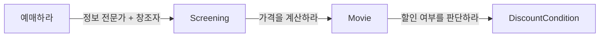
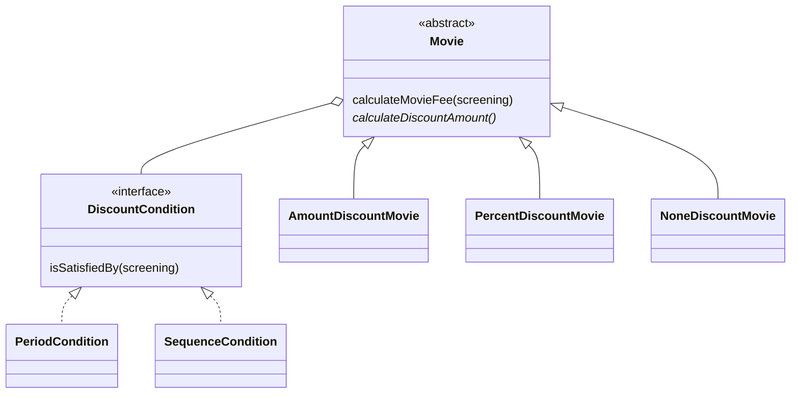

# 오브젝트 5장 - 책임 할당하기

## 전체 내용 요약

4장에서 데이터 중심으로 짰던 영화 예매 시스템을 **책임 중심**으로 다시 설계한다.

책임을 누구에게 줄지 판단할 때 쓰는 원칙들을 **GRASP 패턴**으로 정리하고 차례로 적용해 `Screening` → `Movie` → `DiscountCondition` 순서로 객체를 찾아간다.
설계를 개선하는 과정에서 **응집도를 판단하는 세 가지 기준**, **다형성으로 분기문을 없애는 법**, **상속 대신 합성을 고르는 이유**가 나온다.

마지막으로 책임 주도 설계가 막막할 때 쓸 수 있는 대안으로 **일단 절차적으로 짠 뒤 리팩토링하는** 방법도 제시한다.

## 핵심 내용

### 책임 주도 설계를 향해

데이터 중심 설계가 문제였던 이유는 데이터를 먼저 정하고 협력 없이 오퍼레이션을 정했기 때문이다.

1. **데이터보다 행동을 먼저 결정하라.** 이 객체가 수행해야 할 책임은 무엇인가? 를 먼저 묻고 그 책임에 필요한 데이터는 나중에 정한다.
2. **협력이라는 문맥 안에서 책임을 결정해라.** 책임은 객체가 아니라 협력에 어울려야 한다.

> 메시지를 전송해야 하는데 누구에게 전송하지? 라는 질문이 먼저다.
> 객체가 있어서 메시지를 보내는 것이 아니라, 메시지를 보내야 하기 때문에 객체를 갖게 된 것이다.

**책임 주도 설계의 흐름**

1. 시스템이 사용자에게 제공할 기능(시스템 책임)을 파악한다.
2. 시스템 책임을 더 작은 책임으로 나눈다.
3. 나눈 책임을 수행할 객체나 역할을 찾아 할당한다.
4. 그 객체가 책임을 수행하다 도움이 필요하면, 그 일을 맡을 객체나 역할을 찾는다.
5. 해당 객체에 책임을 할당해 두 객체가 협력하게 한다.

책임이 어느 정도 정리되면 그때 내부 상태를 고려한다.

### GRASP 패턴

GRASP(General Responsibility Assignment Software Pattern)는 객체에 책임을 할당할 때 지침으로 삼을 원칙들을 패턴 형식으로 정리한 것이다.

| 패턴                           | 묻는 질문                      | 영화 예매에서                                                |
| ---------------------------- | -------------------------- | ------------------------------------------------------ |
| 정보 전문가 (INFORMATION EXPERT)  | 이 책임에 필요한 정보를 누가 가장 잘 아는가? | 요금과 할인 조건을 아는 `Movie`가 `가격을 계산하라` 를 맡는다                |
| 낮은 결합도 (LOW COUPLING)        | 어디에 두면 새 의존이 덜 생기나?        | `Movie`는 이미 할인 조건을 가진다. `Screening`이 판단하면 의존이 하나 더 생긴다 |
| 높은 응집도 (HIGH COHESION)       | 어디에 두면 바뀌는 이유가 하나로 모이나?    | `Screening`의 주 책임은 예매하라 다. 요금 계산까지 맡으면 응집도가 낮아진다       |
| 창조자 (CREATOR)                | 객체 A는 누가 만드나?              | `Reservation`을 만들 정보를 가진 `Screening`이 생성한다             |
| 다형성 (POLYMORPHISM)           | 타입에 따라 행동이 바뀌면?            | 순번 조건, 기간 조건을 `DiscountCondition` 인터페이스로 묶는다           |
| 변경 보호 (PROTECTED VARIATIONS) | 변할 것은 무엇이고 어떻게 감추나?        | 새 할인 조건은 인터페이스만 구현하면 된다                                |

#### 정보 전문가 패턴

책임을 수행하는 데 필요한 정보를 가장 잘 아는 객체에게 책임을 맡긴다. 여기서 **정보**는 객체가 직접 가진 데이터만이 아니다. **정보를 제공할 다른 객체를 알고 있거나, 계산해서 제공할 수 있어도 정보 전문가다.**

메시지를 정할 때는 두 질문을 순서대로 던진다.

1. 메시지를 전송할 객체의 의도는 무엇인가?
2. 메시지를 수신할 적합한 객체는 누구인가?

영화 예매에 적용하면 아래처럼 흘러간다.



- **예매하라**: 상영 시간과 상영 순번을 아는 `Screening`이 맡는다.
- **가격을 계산하라**: 기본 요금과 할인 정책을 아는 `Movie`가 맡는다.
- **할인 여부를 판단하라**: 할인 조건을 아는 `DiscountCondition`이 맡는다.

#### 그렇다면 왜 `Screening`이 아니라 `Movie`일까?

할인 여부 판단은 `Screening`이 직접 해도 기능은 똑같이 동작한다. 그래서 정보 전문가 패턴 하나만으로는 판단이 애매할 때가 있다. 이때 **낮은 결합도**와 **높은 응집도** 관점으로 다시 본다.

결합도
- `Movie`는 이미 `DiscountCondition` 목록을 가지고 있다. `Movie`가 판단하면 새 의존이 생기지 않는다. `Screening`이 판단하면 `Screening → DiscountCondition` 의존이 하나 더 생긴다.

응집도
- Screening`의 핵심 책임은 예매를 만드는 것이다. 할인 조건 판단까지 맡으면 요금 계산 방식이 바뀔 때도 `Screening`이 바뀐다.

낮은 결합도와 높은 응집도는 다른 패턴으로 고른 후보를 **검토하는 평가 기준** 역할을 한다.

#### 창조자 패턴

객체 A를 생성해야 할 때, 아래 조건을 많이 만족하는 객체 B에게 생성 책임을 준다.

- B가 A 객체를 포함하거나 참조한다.
- B가 A 객체를 기록한다.
- B가 A 객체를 긴밀하게 사용한다.
- B가 A 객체를 초기화하는 데 필요한 데이터를 가지고 있다. (이때 B는 A의 정보 전문가다.)

목적은 **이미 연결된 객체에게 생성을 맡겨** 결합도를 늘리지 않는 것이다. `Reservation`을 만들려면 상영 정보, 영화, 요금이 필요하고 이것을 가장 잘 아는 것은 `Screening`이다.

```java
public Reservation reserve(Customer customer, int audienCount) {
    return new Reservation(customer, this, calculateFee(audienCount), audienCount);
}

private Money calculateFee(int audienceCount) {
    // Movie에 보내는 메시지의 인자를 Screening으로 해서 송신자의 의도를 표현했다
    return movie.calculateMovieFee(this).times(audienceCount);
}
```

### step01

메시지 흐름대로 구현하면 `Screening`, `Movie`, `DiscountCondition`이 각자 책임을 가진다. 하지만 `DiscountCondition`과 `Movie` 안에 **타입 분기**가 남는다.

```java
public class DiscountCondition {
    private DiscountConditionType type;
    private int sequence;           // 순번 조건에서만 사용
    private DayOfWeek dayOfWeek;    // 기간 조건에서만 사용
    private LocalTime startTime;    // 기간 조건에서만 사용
    private LocalTime endTime;      // 기간 조건에서만 사용

    public boolean isSatisfiedBy(Screening screening) {
        if (type == DiscountConditionType.PERIOD) {
            return isSatisfiedByPeriod(screening);
        }
        return isSatisfiedBySequence(screening);
    }
    ...
}
```

```java
private Money calculateDiscountAmount() {
    switch (movieType) {
        case AMOUNT_DISCOUNT:  return calculateAmountDiscountAmount();
        case PERCENT_DISCOUNT: return calculatePercentDiscountAmount();
        case NONE_DISCOUNT:    return calculateNoneDiscountAmount();
    }
    throw new IllegalStateException();
}
```

`DiscountCondition`은 순번 조건이 바뀌어도, 기간 조건이 바뀌어도 수정해야 한다. **변경의 이유가 둘**이라 응집도가 낮다.

### 응집도를 판단하는 세 가지 기준

설계를 개선하는 일은 보통 **변경의 이유가 둘 이상인 클래스를 찾는 것**에서 시작한다. 하지만 처음에는 이걸 찾기가 어렵다. 그래서 5장은 응집도가 낮다는 기준를 세 가지로 정리한다.

| 기준      | 응집도가 낮다는 신호            | 나누는 기준                    |
| ------- | ---------------------- | ------------------------- |
| 변경 이유   | 클래스가 둘 이상의 이유로 바뀐다     | 변경의 이유                    |
| 초기화 시점  | 경우에 따라 서로 다른 속성만 초기화한다 | 함께 초기화되는 속성 그룹            |
| 메서드와 속성 | 메서드 그룹마다 쓰는 속성 그룹이 다르다 | 속성 그룹 + 그 속성에 접근하는 메서드 그룹 |


step01의 `DiscountCondition`은 세 기준에 모두 걸린다.

- 순번 조건이면 `sequence`만, 기간 조건이면 `dayOfWeek`, `startTime`, `endTime`만 초기화된다.
- `isSatisfiedBySequence()`는 `sequence`만, `isSatisfiedByPeriod()`는 기간 관련 필드만 쓴다.
- 두 조건은 서로 다른 시점에, 서로 다른 이유로 바뀐다.

> "속성 그룹과 해당 그룹에 접근하는 메서드 그룹을 기준으로 코드를 분리해야 한다"는 문장이 처음엔 잘 안 읽혔다.
>
>아직 이해가 잘 안되지만 `DiscountCondition`클래스를 보면 각각 조건에서 사용되는 필드와 메서드를 보면 명확하게 서로 그룹이 나뉘어서 리팩토링 대상이 되는 것 같다.

### 타입 분리와 다형성 - step02

`DiscountCondition`을 `SequenceCondition`과 `PeriodCondition`으로 나눴다. 각 클래스는 자기 속성을 생성 시점에 모두 함께 초기화하고, 메서드도 자기 속성을 모두 쓴다.

```java
// PeriodCondition.java
public class PeriodCondition implements DiscountCondition {
    private DayOfWeek dayOfWeek;
    private LocalTime startTime;
    private LocalTime endTime;

    public boolean isSatisfiedBy(Screening screening) {
        return dayOfWeek.equals(screening.getWhenScreend().getDayOfWeek()) &&
                startTime.compareTo(screening.getWhenScreend().toLocalTime()) <= 0 &&
                endTime.compareTo(screening.getWhenScreend().toLocalTime()) >= 0;
    }
}

// SequenceCondition.java
public class SequenceCondition implements DiscountCondition {
    private int sequence;

    public boolean isSatisfiedBy(Screening screening) {
        return sequence == screening.getSequence();
    }
}
```

그런데 나누고 나면 새 문제가 생긴다. `Movie`가 `PeriodCondition` 목록과 `SequenceCondition` 목록을 따로 가져야 한다. 즉 `Movie`가 두 클래스 모두에 결합한다. 새 조건이 추가되면 `Movie`도 고쳐야 한다.

**역할**을 사용한다. 두 조건은 `할인 여부를 판단한다`는 같은 책임을 수행하므로 같은 역할로 묶을 수 있다.

```java
// DiscountCondition.java
public interface DiscountCondition {
    public boolean isSatisfiedBy(Screening screening);
}

// Movie.java
private boolean isDiscountable(Screening screening) {
    return discountConditions.stream()
            .anyMatch(condition -> condition.isSatisfiedBy(screening));
}
```

이제 `Movie`는 조건의 실제 타입을 몰라도 된다. 메시지를 받은 객체가 자기 타입에 맞게 알아서 처리한다.

역할을 구현하는 방법은 두 가지다.

| 방법 | 고르는 경우 |
| --- | --- |
| 추상 클래스 | 역할을 수행하는 클래스들이 **공통 구현을 공유**해야 할 때 |
| 인터페이스 | 구현 공유 없이 **책임만 정의**하고 싶을 때 |

할인 조건은 공유할 공통 구현이 없어서 인터페이스를 사용했다.

> **POLYMORPHISM 패턴**
> 객체의 타입에 따라 변하는 행동이 있다면 타입을 분리하고 변하는 행동을 각 타입의 책임으로 할당하라. 보통 타입마다 `if`/`switch`가 늘어날 때 고려한다.

> **PROTECTED VARIATIONS 패턴**
> 설계에서 변하는 것이 무엇인지 고려하고 변하는 개념을 캡슐화하라.
> 새로운 할인 조건이 추가되어도 인터페이스를 실체화하기만 하면 되므로 `Movie`는 바뀌지 않는다.

정리하면

- 하나의 클래스 안에 여러 타입이 보이면 → **다형성**을 고려한다.
- 예측 가능한 변경 때문에 여러 클래스가 불안정해지면 → **캡슐화**를 고려한다.

클래스를 변경에 따라 분리하고 인터페이스로 변경을 캡슐화하는 것은 결합도와 응집도를 함께 개선하는 강력한 방법이다.

### Movie 개선하기 - step02

`Movie`의 할인 금액 계산 `switch`도 같은 방식으로 없앴다. 할인 금액 계산을 추상 메서드로 선언하고, 정책마다 하위 클래스를 만들었다.

```java
// Movie.java
public abstract class Movie {
    ...
    public Money calculateMovieFee(Screening screening) {
        if (isDiscountable(screening)) {
            return fee.minus(calculateDiscountAmount());
        }
        return fee;
    }

    abstract protected Money calculateDiscountAmount();
}

// AmountDiscountMovie.java
public class AmountDiscountMovie extends Movie {
    private Money discountAmount;

    @Override
    protected Money calculateDiscountAmount() {
        return discountAmount;
    }
}
```



> 구현을 가이드할 수 있는 도메인 모델을 선택하라.
> 그러면 도메인 모델의 구조가 코드의 구조를 이끌어 내는 것이 자연스러워진다.

### 변경과 유연성 - step03

변경에 대비하는 방법은 두 가지다.

1. 코드를 이해하고 수정하기 쉽도록 **최대한 단순하게** 설계한다.
2. 코드를 수정하지 않고도 변경을 수용할 수 있도록 **더 유연하게** 만든다.

대부분은 1번이 낫다. 하지만 같은 종류의 변경이 반복된다면 2번을 고려한다.

step02는 할인 정책이 `Movie`의 **하위 타입으로 고정**되어 있다. 이 상태에서 실행 중에 할인 정책을 바꿔 보면 문제가 드러난다.

```java
Movie avatar = new AmountDiscountMovie(...);

// 불가능: 자바는 생성된 객체의 클래스를 실행 중에 바꿀 수 없다
avatar.changeClass(PercentDiscountMovie.class);

// 그래서 새 객체를 만들고 상태를 복사해야 한다
Movie changedAvatar = new PercentDiscountMovie(
    avatar.getTitle(),
    avatar.getRunningTime(),
    avatar.getFee()
);
```

이 과정에서 두 가지 문제가 생긴다.

1. **모든 상태를 직접 복사해야 한다.** 누락이나 잘못된 복사로 오류가 나기 쉽다.
2. **같은 영화인데 다른 객체가 된다.** `avatar == changedAvatar`는 `false`다. 기존 영화를 참조하던 다른 객체의 참조도 모두 바꿔야 한다.

```java
reservation.getMovie() == avatar;        // true
reservation.getMovie() == changedAvatar; // false
```

> 상속을 이용하면 할인 정책이 영화의 타입에 고정된다.
> 실행 중 정책을 바꾸려면 새 영화 객체를 만들고 상태와 참조를 옮겨야 하고, 이 때문에 상태 복사 오류와 객체 식별자 관리 문제가 생긴다.

해결책은 **합성**이다. 할인 정책을 `Movie`의 하위 타입이 아니라 `Movie`가 **가지는** 객체로 뺐다.

```java
// Movie.java
public class Movie {
    private Money fee;
    private DiscountPolicy discountPolicy;

    public Money calculateMovieFee(Screening screening) {
        return fee.minus(discountPolicy.calculateDiscountAmount(screening));
    }

    public void changeDiscountPolicy(DiscountPolicy discountPolicy) {
        this.discountPolicy = discountPolicy;
    }
}

// DiscountPolicy.java
public abstract class DiscountPolicy {
    private List<DiscountCondition> conditions = new ArrayList<>();

    public Money calculateDiscountAmount(Screening screening) {
        for (DiscountCondition condition : conditions) {
            if (condition.isSatisfiedBy(screening)) {
                return getDiscountAmount(screening);
            }
        }
        return Money.ZERO;
    }

    abstract protected Money getDiscountAmount(Screening screening);
}
```

이제 같은 `Movie` 객체를 유지한 채 `changeDiscountPolicy()`로 정책만 갈아 끼울 수 있다. 2장에서 본 구조와 같은 모양이 됐다.

|            | step02 - 상속             | step03 - 합성                     |
| ---------- | ----------------------- | ------------------------------- |
| 할인 정책 위치   | `Movie`의 하위 클래스         | `Movie`가 가진 `DiscountPolicy` 필드 |
| 실행 중 정책 변경 | 새 객체 생성 + 상태 복사 + 참조 변경 | `changeDiscountPolicy()` 한 번    |
| 객체 식별자     | 바뀐다                     | 그대로다                            |

> 요소들 사이의 의존성의 정도가 유연성의 정도를 결정한다.
> 유연성의 정도에 따라 결합도를 조절할 수 있는 능력을 갖춰야 한다.

> 코드의 구조가 바뀌면 도메인에 대한 관점도 함께 바뀐다.
> 도메인 모델은 개념과 관계를 모아 둔 것에 그치지 않고, 구현과 밀접하게 맞물려 코드의 변화에 맞춰 함께 변해야 한다.

### 책임 주도 설계의 대안: 리팩토링

> **리팩토링**
> 프로그램의 외부 동작은 유지한 채, 내부 코드의 구조와 품질을 개선하는 작업

처음부터 책임 주도로 생각하는 것은 어렵고 반복 학습이 필요하다. 막막할 때는 **일단 절차적으로 짜서 동작하게 만든 뒤 리팩토링**하는 것도 좋은 설계에 이르는 방법이다.

4장의 `ReservationAgency.reserve()`로 직접 해 봤다.

**1단계: 몬스터 메서드 쪼개기 - V1**

원래 `reserve()`는 할인 여부 판단 루프와 요금 계산 `switch`가 한 메서드에 다 들어 있는 긴 메서드(**몬스터 메서드**)였다. 긴 메서드는 어디를 고쳐야 할지 찾기 어렵고 일부만 재사용하기도 어렵다.

목적이 분명한 작은 메서드로 쪼개니, `reserve()`만 읽어도 흐름이 보인다.

```java
// ReservationAgencyV1.java
public Reservation reserve(Screening screening, Customer customer, int audienceCount) {
    boolean discountable = checkDiscountable(screening);
    Money fee = calculateFee(screening, discountable, audienceCount);
    return createReservation(screening, customer, audienceCount, fee);
}
```

메서드가 응집도 있게 쪼개지면 각 메서드가 **어떤 데이터를 주로 쓰는지**도 보인다. `isSatisfiedByPeriod()`, `isSatisfiedBySequence()`는 `DiscountCondition`의 데이터만 쓴다.

**2단계: 데이터를 가진 객체로 옮기기 - V2**

할인 여부 판단을 데이터의 주인인 `DiscountCondition`으로 옮겼다.

```java
// DiscountCondition.java
public boolean isDiscountable(Screening screening) {
    if (type == DiscountConditionType.PERIOD) {
        return isSatisfiedByPeriod(screening);
    }
    return isSatisfiedBySequence(screening);
}

// ReservationAgencyV2.java
private boolean checkDiscountable(Screening screening) {
    return screening.getMovie().getDiscountConditions().stream()
            .anyMatch(condition -> condition.isDiscountable(screening));
}
```

이 과정을 반복하면(요금 계산은 `Movie`로, 조건 타입 분기는 다형성으로) 처음부터 GRASP로 설계한 step01~03과 비슷한 모양에 도착한다. V2는 아직 요금 계산 `switch`가 `ReservationAgency`에 남아 있고, `DiscountCondition`의 getter/setter도 그대로다.

## 내 생각

프로젝트 코드에서 메서드의 길이가 긴 것을 찾아 리팩토링 할 부분이 있는지 봐야할 거 같다. 배운 내용을 실제 코드에 적용해보는 것이 중요한 거 같다.

## 궁금한 것

**Q1. 다형성으로 타입을 나누면 각 클래스 응집도는 오르는데, 쓰는 쪽은 여러 타입을 알아야 하지 않나?**

> 그래서 나눈 뒤에 **역할로 묶는 단계**가 같이 필요하다. 타입 분리만 하면 `Movie`가 `PeriodCondition`, `SequenceCondition` 둘 다에 결합한다. `DiscountCondition` 인터페이스로 묶어야 `Movie`가 구체 타입을 몰라도 된다. 응집도와 결합도를 함께 챙겨야 한다.

**Q2. 정보 전문가 패턴만 따르면 안 될까?**

> 정보를 가진 객체가 여럿이거나, 정보를 가졌다는 이유로 한 객체에 책임이 몰리면 응집도가 낮아진다. 할인 여부 판단을 `Screening`에 둬도 기능은 같았던 것처럼 정보 전문가로 후보를 고른 뒤 낮은 결합도, 높은 응집도로 다시 검토해야 한다.

그렇다면 처음부터 GRASP로 책임을 할당하는 것과, 절차적으로 짠 뒤 리팩토링하는 것 중 실제 프로젝트에서는 어느 쪽이 현실적일까?
