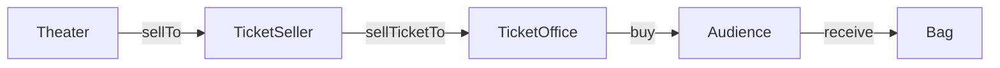

# 오브젝트 6장 - 메시지와 인터페이스

## 전체 내용 요약

객체는 **메시지**로만 협력한다. 6장은 메시지, 메서드, 오퍼레이션, 퍼블릭 인터페이스 같은 용어를 먼저 정리하고 **좋은 퍼블릭 인터페이스**를 만드는 네 가지 원칙을 다룬다.

- 디미터 법칙
- 묻지 말고 시켜라
- 의도를 드러내는 인터페이스
- 명령-쿼리 분리

그리고 이 원칙들을 **맹목적으로 따랐을 때의 함정**을 함께 보여 준다. 결론은 5장과 비슷하다. 원칙을 지키는 가장 쉬운 방법은 **메시지를 먼저 고르고 그 메시지를 처리할 객체를 고르는 것**이다.

## 핵심 내용

### 협력과 메시지

객체 사이의 협력은 **클라이언트 - 서버** 구조를 닮았다.

- 클라이언트: 메시지를 전송하며 요청하는 객체
- 서버: 메시지를 수신하고 응답하는 객체

보통 협력은 클라이언트가 서버에게 요청하는 단방향이다. 하지만 더 큰 책임을 수행하려면 서버도 다른 객체에게 다시 요청해야 한다. 그래서 **한 객체는 클라이언트이면서 서버**가 될 수 있다.

객체의 메시지는 두 집합으로 볼 수 있다.

1. 객체가 **수신**하는 메시지 집합
2. 외부의 객체에게 **전송**하는 메시지 집합

### 메시지와 관련된 용어

| 용어            | 뜻                                                          |
| ------------- | ---------------------------------------------------------- |
| 메시지           | 객체들이 협력하기 위해 쓸 수 있는 유일한 의사소통 수단. <br>**오퍼레이션명 + 인자**       |
| 메시지 전송        | 메시지 + **수신자**, 메시지 패싱이라고도 한다                               |
| 메시지 전송자 / 수신자 | 메시지를 보내는 객체 / 받는 객체                                        |
| 메서드           | 메시지를 수신했을 때 **실제로 실행되는** 함수나 프로시저                          |
| 퍼블릭 인터페이스     | 객체가 의사소통을 위해 외부에 공개하는 메시지의 집합                              |
| 오퍼레이션         | 퍼블릭 인터페이스에 포함된 메시지. <br>수행 가능한 행동에 대한 추상화이고, 보통 시그니처를 가리킨다 |
| 시그니처          | 오퍼레이션명 + 파라미터 목록                                           |

```java
condition.isSatisfiedBy(screening);
// 수신자     오퍼레이션명    인자

// 오퍼레이션명 + 인자          = 메시지
// 오퍼레이션명 + 인자 + 수신자 = 메시지 전송
```

#### 메시지와 메서드를 나누는 이유

같은 이름의 변수에 같은 메시지를 보내도 **수신자의 실제 타입**에 따라 실행되는 메서드가 달라진다.
코드의 의미가 컴파일 시점과 실행 시점에 다를 수 있는 이유는 다형성 때문이다.

메시지와 메서드를 구분하면 전송자와 수신자가 느슨하게 결합한다.

- 전송자는 **어떤 메시지를 보낼지**만 안다.
- 수신자는 **메시지를 받아 어떻게 처리할지**에만 집중한다.

실행 시점에 메시지와 메서드를 묶는 메커니즘 덕분에 두 객체의 결합도가 낮아지고, 유연하고 확장 가능한 코드가 된다.

오퍼레이션 관점에서 다형성을 다시 정의하면 이렇다.

> **같은 오퍼레이션 호출에 대해 서로 다른 메서드들이 실행되는 것**

5장의 할인 조건이 그 예다. `Movie`는 `isSatisfiedBy(screening)`이라는 오퍼레이션 하나만 호출하고 실제로는 수신한 객체의 타입에 따라 `PeriodCondition`과 `SequenceCondition`의 메서드가 각각 실행된다.

### 인터페이스와 설계 품질

좋은 인터페이스는 두 조건을 만족한다.

| 조건 | 뜻 |
| --- | --- |
| 최소한의 인터페이스 | 꼭 필요한 오퍼레이션만 인터페이스에 포함한다 |
| 추상적인 인터페이스 | **어떻게** 수행하는지가 아니라 **무엇을** 하는지 표현한다 |

책임 주도 설계로 설계하면 두 조건을 자연스럽게 충족한다.

- 메시지를 먼저 고르므로 협력과 무관한 오퍼레이션이 인터페이스에 끼어들지 않는다.
- 메시지가 객체를 고르게 하므로 클라이언트의 의도가 메시지에 드러난다.

### 디미터 법칙

4장 `ReservationAgency`는 `Screening`, `Movie`, `DiscountCondition`의 내부 데이터를 줄줄이 꺼내 썼다. 협력하는 객체의 **내부 구조에 결합**해서 생긴 문제다. 이를 해결하는 원칙이 디미터 법칙이다.

> 객체의 내부 구조에 강하게 결합되지 않도록 협력 경로를 제한하라.
>
> 낯선 자에게 말하지 말라 (don't talk to strangers)
> 오직 인접한 이웃하고만 말하라 (only talk to your immediate neighbors)

```java
public Reservation reserve(Screening screening, Customer customer, int audienceCount) {
    Money fee = screening.calculateFee(audienceCount);
    return new Reservation(customer, screening, fee, audienceCount);
}
```

이 코드는 인자로 받은 `Screening`에게만 메시지를 보낸다. `Screening`의 내부 구조에 의존하지 않으므로 결합도가 낮다. 이렇게 법칙을 따른 코드를 **부끄럼타는 코드(shy code)**라 한다.

> **shy code**
> 불필요한 것을 외부에 노출하지 않고, 다른 객체의 구현에 의존하지 않는 코드

반대로 디미터 법칙을 위반하는 전형적인 코드는 아래와 같이 생겼다.

```java
screening.getMovie().getDiscountConditions();
```

전송자가 수신자의 내부 구조를 물어보고, 반환받은 객체에 다시 연쇄적으로 메시지를 보낸다. 이런 코드를 **기차 충돌**(train wreck)이라 부른다. 클래스의 내부 구현이 외부로 노출됐을 때 나타나는 전형적인 모양이다.

법칙을 따르도록 고치면 전송자는 더 이상 내부 구조를 묻지 않는다.
원하는 것을 명시하고 수행하라고 요청할 뿐이다.

```java
screening.calculateFee(audienceCount);
```

### 묻지 말고 시켜라

다른 객체의 상태를 꺼내 **밖에서 판단하지 말고**, 그 객체에게 일을 시키라는 원칙이다.

- 함께 변경될 확률이 높은 정보와 행동은 하나의 단위로 묶는다.
- 객체의 정보를 이용하는 행동은 외부가 아니라 **그 객체 내부**에서 수행한다.
- 이 원칙을 따르면 자연스럽게 **정보 전문가**에게 책임이 가고, 응집도가 높은 클래스를 얻을 확률이 높아진다.

> 내부 상태를 이용해 결정을 내리는 로직이 객체 밖에 있다면 그 객체가 책임져야 할 행동이 밖으로 새어 나간 것이다.
> 인터페이스에 상태를 묻는 오퍼레이션이 있다면 **행동을 요청하는 오퍼레이션**으로 바꿀 수 없는지 고민하자.

### 의도를 드러내는 인터페이스

메서드 이름을 지을 때 흔히 작업을 **어떻게** 하는지를 이름에 넣는다.

```java
public class Card {
    public void payByCard(...) { ... }
}

public class Cash {
    public void payByCash(...) { ... }
}
```

이 방식은 두 가지 문제가 있다.

1. **커뮤니케이션이 안 된다.** 두 메서드는 같은 일인 결제를 하는데 이름만 봐서는 알기 어렵다.
2. **캡슐화를 위반한다.** 클라이언트가 협력하는 객체의 종류(카드인지 현금인지)를 알아야 한다. 결제 방법이 바뀌면 클라이언트 코드도 바뀐다.

메서드 이름은 How가 아니라 **What**을 드러내야 한다.

```java
public interface Pay {
    void payBy(...);
}

public class Card implements Pay {
    @Override
    public void payBy(...) { ... }
}

public class Cash implements Pay {
    @Override
    public void payBy(...) { ... }
}
```

이제 두 메서드가 같은 일을 한다는 것이 이름에 드러난다. 결제 수단이 추가되든 삭제되든 클라이언트는 `payBy` 메시지만 보내면 되고, 실행 시점에 수신한 객체의 타입에 맞는 메서드가 실행된다.

### 함께 모으기 - 1장 소극장 다시 보기

세 원칙(디미터 법칙, 묻지 말고 시켜라, 의도를 드러내는 인터페이스)은 위반한 코드를 보면 이해가 쉽다. 1장의 첫 `Theater`가 좋은 예다.

```java
// Theater.java
public void enter(Audience audience) {
    if (audience.getBag().hasInvitation()) {
        Ticket ticket = ticketSeller.getTicketOffice().getTicket();
        audience.getBag().setTicket(ticket);
    } else {
        Ticket ticket = ticketSeller.getTicketOffice().getTicket();
        audience.getBag().minusAmount(ticket.getFee());
        ticketSeller.getTicketOffice().plusAmount(ticket.getFee());
        audience.getBag().setTicket(ticket);
    }
}
```

인자로 받은 `audience`와 인스턴스 변수 `ticketSeller`에게 메시지를 보내는 것 자체는 문제가 아니다. 문제는 **그 안의 `Bag`과 `TicketOffice`까지 들어가서** 상태를 판단하고 제어하는 것이다.

```java
audience.getBag().minusAmount(ticket.getFee());
```

이 한 줄로 `Theater`는 `Audience`뿐 아니라 `Audience` 안의 `Bag`에도 결합한다. `관람객이 가방을 가진다`는 사실은 `Audience`의 내부 구조다. 결국 `Theater`는 관람객이 가방을 가지고 가방에서 돈을 뺄 수 있고 판매원이 매표소에서 티켓을 꺼내 준다는 것까지 모두 알아야 한다.

> 디미터 법칙을 위반하는 설계는 **인터페이스와 구현의 분리 원칙**을 위반한다.
> 외부에 노출되는 객체 사이의 관계가 많을수록 결합도가 높아지고 작은 요구사항 변경에도 쉽게 무너진다.

묻지 말고 시켜라를 적용한 step05는 각자에게 행동을 **시킨다**.

```java
// Theater: 판매원에게 판매하라고 시킨다
public void enter(Audience audience) {
    ticketSeller.sellTo(audience);
}

// TicketSeller: 매표소에게 판매하라고 시킨다
public void sellTo(Audience audience) {
    ticketOffice.sellTicketTo(audience);
}

// TicketOffice: 관람객에게 구매하라고 시킨다
public void sellTicketTo(Audience audience) {
    Long paid = audience.buy(tickets.get(0));
    tickets.remove(0);
    plusAmount(paid);
}

// Audience: 가방에게 티켓을 받으라고 시킨다
public Long buy(Ticket ticket) {
    return bag.receive(ticket);
}
```



소극장은 판매원에게, 판매원은 매표소에게, 매표소는 관람객에게, 관람객은 가방에게 일을 시킨다. 내부 구현은 밖에 드러나지 않고, 메서드 이름(`sellTo`, `buy`, `receive`)이 클라이언트가 원하는 것을 그대로 드러낸다.

### 원칙의 함정

설계 원칙을 처음 접하면 맞지 않는 상황에서도 원칙을 적용하려고 정당성을 부여하게 된다.
원칙에는 늘 예외가 존재한다.

#### . 이 여러 개라고 위반이 아니다

```java
IntStream.of(1, 15, 20, 3, 9).filter(x -> x > 10).distinct().count();
```

점이 여러 개지만 디미터 법칙 위반이 아니다. 기준은 점의 개수가 아니라 **결합도**다. 체이닝처럼 보여도 객체의 내부 구현에 대해 아무것도 묻지 않는다면 법칙을 지킨 것이다.

> 여러 개의 도트를 쓴 코드가 **객체의 내부 구조를 노출하고 있는가?** 로 판단한다.

#### 결합도와 응집도의 충돌

1장의 `enter()`는 관람객의 내부 구조를 꺼내 마음대로 제어했다. 해결책은 내부 구조를 다루는 코드를 `Audience` 안으로 숨기는 것, 즉 **위임 메서드**를 추가하는 것이었다. 관람객이 자기 상태를 스스로 제어하니 `Theater`와의 결합도는 낮아지고 응집도는 높아졌다.

하지만 원칙을 맹목적으로 따라 위임 메서드를 계속 늘리면, 퍼블릭 인터페이스에 어울리지 않는 오퍼레이션이 쌓인다. 객체가 상관없는 책임까지 떠안게 되어 **응집도가 낮아진다**. 클래스는 하나의 변경 원인만 가져야 한다.

대표적인 예가 기간 조건 판단이다.

```java
// PeriodCondition이 Screening의 상태를 꺼내 판단한다
public boolean isSatisfiedBy(Screening screening) {
    return dayOfWeek.equals(screening.getWhenScreend().getDayOfWeek()) &&
            startTime.compareTo(screening.getWhenScreend().toLocalTime()) <= 0 &&
            endTime.compareTo(screening.getWhenScreend().toLocalTime()) >= 0;
}
```

원칙만 보면 `Screening`의 상태를 꺼내 쓰니 좋지 않은 코드처럼 보인다. 그래서 판단 책임을 `Screening`으로 옮기면 어떻게 될까? `Screening`의 주 책임은 **예매하라**다. 기간 조건 판단까지 맡으면 예매와 상관없는 이유로도 `Screening`이 바뀐다.

#### 묻는 대상이 데이터라면

```java
for (Movie each : movies) {
    total += each.getFee();
}
```

물으려는 객체가 정말로 데이터(자료 구조)라면 디미터 법칙을 따르지 않아도 된다.

### 명령 - 쿼리 분리 원칙

퍼블릭 인터페이스에 오퍼레이션을 정의할 때 참고할 수 있는 지침이다.

**용어 정리**

- **루틴**: 어떤 절차를 묶어 호출할 수 있게 이름을 붙인 기능 모듈. 프로시저와 함수로 나뉜다.
- **프로시저**: 정해진 절차에 따라 내부 상태를 변경한다. 부수효과를 발생시킬 수 있지만 **값을 반환할 수 없다**.
- **함수**: 절차에 따라 필요한 값을 계산해서 반환한다. 값을 반환할 수 있지만 **부수효과를 발생시킬 수 없다**.

명령과 쿼리는 객체의 인터페이스 측면에서 프로시저와 함수를 부르는 다른 이름이다.

| | 하는 일 | 규칙 |
| --- | --- | --- |
| 명령 (Command) | 객체의 상태를 수정한다 | 반환값을 가질 수 없다 |
| 쿼리 (Query) | 객체와 관련된 정보를 반환한다 | 상태를 변경할 수 없다 |

> 어떤 오퍼레이션도 명령인 동시에 쿼리여서는 안 된다.

이 원칙을 지킨 인터페이스를 **명령 - 쿼리 인터페이스**라 한다. 명령 버튼을 누르면 기계의 상태가 바뀌지만 바뀐 상태를 알 수 없고 쿼리 버튼을 누르면 상태를 알 수 있지만 바꿀 수 없는 것과 같다.

#### 반복 일정 예제 - 쿼리처럼 보이는 명령

반복되는 일정을 관리하는 소프트웨어를 가정한다.

- **이벤트**: 특정 일자에 실제로 발생하는 사건
- **반복 일정**: 일정한 간격으로 발생하는 사건 전체

`Event.isSatisfied()`는 이벤트가 반복 일정 조건을 만족하는지 확인하는 메서드다.

```java
// Event.java
public boolean isSatisfied(RecurringSchedule schedule) {
    if (from.getDayOfWeek() != schedule.getDayOfWeek() ||
        !from.toLocalTime().equals(schedule.getFrom()) ||
        !duration.equals(schedule.getDuration())) {
        reschedule(schedule);   // 조회 메서드 안에서 상태를 바꾼다
        return false;
    }
    return true;
}

private void reschedule(RecurringSchedule schedule) {
    from = LocalDateTime.of(from.toLocalDate().plusDays(daysDistance(schedule)), schedule.getFrom());
    duration = schedule.getDuration();
}
```

원래 `isSatisfied()`는 조회만 하는 쿼리였다. 그런데 `조건에 맞지 않으면 이벤트를 일정에 맞게 고쳐야 한다`는 요구사항이 추가되면서 누군가 이 메서드 안에 `reschedule()` 호출을 넣었다.

매주 수요일 10:30 30분 반복 일정과, 목요일(2019-05-09) 10:30 30분 이벤트를 만들고 `isSatisfied()`를 두 번 부르게 실행했다.

```java
Event meeting = new Event("회의", LocalDateTime.of(2019, 5, 9, 10, 30), Duration.ofMinutes(30));
RecurringSchedule schedule = new RecurringSchedule("회의", DayOfWeek.WEDNESDAY, LocalTime.of(10, 30), Duration.ofMinutes(30));

meeting.isSatisfied(schedule); // false
meeting.isSatisfied(schedule); // true  ← 같은 호출인데 결과가 다르다
```

첫 호출에서 `reschedule()`이 이벤트를 5월 8일 수요일로 옮겨 버렸기 때문에, 두 번째 호출은 `true`가 된다. 겉으로는 쿼리처럼 보이는 메서드에 명령이 섞이면 결과를 예측하기 어렵고 버그 지점도 찾기 어렵다.

해결책은 명령과 쿼리를 명확하게 나누는 것이다.

```java
// Event.java
public boolean isSatisfied(RecurringSchedule schedule) { ... }   // 쿼리: 판단만 한다

public void reschedule(RecurringSchedule schedule) { ... }       // 명령: 상태만 바꾼다
```

```java
meeting.isSatisfied(schedule); // false
meeting.isSatisfied(schedule); // false  ← 몇 번을 불러도 같다
meeting.reschedule(schedule);
meeting.isSatisfied(schedule); // true
```

`reschedule()`은 클라이언트가 직접 부를 수 있도록 `public`이 됐다.

> 반환값이 없는 메서드는 대부분 명령이므로 호출할 때 부수효과에 주의한다.
> 부수효과가 있는지 코드를 일일이 분석하는 것보다, **반환값이 있는지만 보는 것**이 훨씬 간단하다.

명령과 쿼리를 나누면 코드는 예측 가능해지고, 이해하기 쉬워지고, 디버깅과 유지보수가 수월해진다.

#### 명령-쿼리 분리와 참조 투명성

> **참조 투명성**
> 어떤 표현식 e를, e의 값으로 모든 위치에서 바꿔도 결과가 달라지지 않는 특성
> → 계산식을 그 계산 결과로 바꿔 써도 프로그램의 결과가 같으면 참조 투명하다.

`add(2, 3)`이 항상 5를 반환하고 다른 상태를 바꾸지 않는다면

```java
int result = add(2, 3) * add(2, 3);
// 아래처럼 바꿔도 결과는 25로 같다
int result = 5 * 5;
```

반면 `count++`는 값을 반환하면서 `count`도 바꾸므로, 반환값으로 대체하면 상태 변화가 사라진다. 참조 투명하지 않다.

수학에서 `f(1) = 3`이면 그 값은 바뀌지 않는다. 이런 성질을 **불변성**이라 한다.

> 불변성 = 부수효과 없음 = 참조 투명성 만족

| | 명령형 프로그래밍 | 함수형 프로그래밍 |
| --- | --- | --- |
| 기반 | 부수효과(상태 변경) | 부수효과가 없는 수학적 함수 |
| 프로그램 작성 | 상태를 바꾸는 연산을 순서대로 나열 | 함수를 조합 |
| 예 | 대부분의 객체지향 언어 | |

객체지향은 객체의 상태 변경이라는 부수효과를 기반으로 하므로 참조 투명성은 예외에 가깝다. 그래도 명령-쿼리 분리를 지키면 **쿼리만큼은** 참조 투명하게 만들 수 있다. 위 반복 일정 예제의 step02 `isSatisfied()`가 그렇다.

### 책임에 초점을 맞춰라

네 원칙을 지키며 인터페이스를 설계하는 가장 쉬운 방법은

> **메시지를 먼저 선택하고, 그 후에 메시지를 처리할 객체를 선택하는 것**

5장의 책임 주도 설계와 같은 결론이다.

> **계약에 의한 설계**
> 협력을 위해 클라이언트와 서버가 지켜야 하는 제약을 코드에 명시적으로 표현하고 강제하는 방법이다.

| 원칙 | 한 줄 요약 |
| --- | --- |
| 디미터 법칙 | 바로 옆 이웃에게만 메시지를 보낸다. 내부 구조를 타고 들어가지 않는다 |
| 묻지 말고 시켜라 | 상태를 꺼내 밖에서 판단하지 말고, 그 객체에게 일을 시킨다 |
| 의도를 드러내는 인터페이스 | 메서드 이름에 어떻게(How)가 아니라 무엇(What)을 드러낸다 |
| 명령-쿼리 분리 | 상태를 바꾸거나 값을 돌려주거나, 둘 중 하나만 한다 |

## 내 생각

명령 - 쿼리 분리 법칙은 생각보다 잘 지켜야 하는 것 같다. 머리 속으론 중요하다 생각이 드는데 실제로 관련 상황을 오류로 겪어보지 못해 잘 와닿지는 않는다.

getter를 지양해야 하냐 마냐의 대한 고민을 저번 주부터 이어오고 있었는데 이번 장을 공부하고 나서 명확하게 생각이 들었다. 꺼내온 값으로 해당 객체가 해야 할 일을 대신 수행하지만 않으면 괜찮은 거 같다. 꺼내온 값에 대한 판단만 지양하면 될 거 같다.

## 궁금한 것

**Q1. getter로 내부 상태를 받아 온다고 할 때, 그 상태의 타입이 바뀌면 결국 수정의 여파가 있지 않나? 그러면 접근자를 지양하는 게 맞지 않나? `Money`의 `amount`가 `Long`이라면 `getFee()`는 영향을 받지 않나?**

> `getFee()`가 무엇을 돌려주느냐에 따라 다르다.
>
> - `getFee()`가 `Money`를 돌려주면, `Money` 안의 `amount`가 `BigDecimal`에서 `Long`으로 바뀌어도 `getFee()`의 반환 타입은 그대로다. `Money`가 자기 내부 표현을 감추고 있기 때문이다. 이것이 금액을 `long`이 아니라 `Money` 같은 값 객체로 감싸는 이유 중 하나다.
> - 반대로 `getAmount()`처럼 내부 필드를 그대로 꺼내 주는 getter라면, 필드 타입이 바뀔 때 반환 타입과 호출하는 쪽이 함께 바뀐다. 4장에서 본 "`fee`의 타입을 바꾸면 `getFee()`와 `ReservationAgency`가 함께 바뀐다"가 이 경우다.
>
> 그래서 "접근자를 쓰지 말라"보다는 **꺼낸 값으로 밖에서 판단하고 있지 않은지**를 보는 게 기준이다. 결과를 돌려주는 쿼리(`calculateFee()`)는 괜찮고, 판단 재료를 꺼내 주는 getter는 의심해 본다.

**Q2. 기간 조건 판단 책임을 `Screening`에 주면 결합도는 낮아지지 않나? 책에서는 높아진다고 했다.**

- **내 생각:** `Screening`이 자기 내부 상태를 스스로 이용해서 판단하므로 결합도는 낮아지고, 대신 상관없는 책임을 떠안아 응집도가 낮아진다고 생각했다.

> 결합도가 **어느 방향으로** 생기는지를 보면 책의 말이 이해된다.
>
> 기간 조건 판단을 `Screening`으로 옮기면 대략 이런 모양이 된다.
>
> ```java
> // Screening
> public boolean isDiscountable(DayOfWeek dayOfWeek, LocalTime startTime, LocalTime endTime) {
>     return whenScreened.getDayOfWeek().equals(dayOfWeek) && ...;
> }
>
> // PeriodCondition
> public boolean isSatisfiedBy(Screening screening) {
>     return screening.isDiscountable(dayOfWeek, startTime, endTime);
> }
> ```
>
> - `PeriodCondition → Screening` 방향: `getWhenScreend()`로 꺼내 쓰던 것이 사라지니 이쪽 결합은 줄어든다. 내 생각은 이 방향만 본 것이다.
> - `Screening → PeriodCondition` 방향: 대신 `Screening`이 기간 조건의 **인스턴스 변수 목록(요일, 시작 시각, 끝 시각)을 파라미터로 받게 된다.** 기간 조건에 필드가 하나 추가되면 `Screening`의 메서드 시그니처도 바뀐다. 원래는 없던 결합이 새로 생긴다.
>
> 즉 한쪽 결합을 없앤 대신 반대쪽에 결합이 생기고, `Screening`은 예매와 상관없는 이유(기간 조건 변경)로도 바뀌게 되어 응집도도 낮아진다. 그래서 이 경우는 `PeriodCondition`이 `Screening`에게 상영 시각을 묻는 지금 구조가 더 낫다.

**Q3. "물으려는 객체가 정말로 데이터라면 법칙을 따르지 않아도 된다"는 무슨 말인가?**

> 객체와 자료 구조를 구분하는 이야기다.
>
> - **객체**는 내부를 감추고 행동(메서드)을 드러낸다. 그래서 상태를 묻지 말고 시켜야 한다.
> - **자료 구조**는 처음부터 데이터를 드러내는 것이 목적이다. 감출 내부 구현도, 맡길 행동도 없다. 이런 대상에게서 값을 꺼내 쓰는 것은 내부 구조에 결합하는 게 아니라 원래 용도대로 쓰는 것이다.
>
> `movies`를 돌며 `each.getFee()`를 더하는 예는, 영화 목록에서 요금을 모으는 일이 각 `Movie`의 책임이라기보다 목록을 쓰는 쪽의 일이라는 뜻으로 읽힌다. 결국 기준은 이번에도 **"꺼낸 값으로 그 객체가 해야 할 판단을 내가 대신 하고 있는가?"**다.

**Q4. 1장 step05의 `Audience.buy()`와 `Bag.receive()`는 명령-쿼리 분리를 지킨 걸까?**

```java
public Long receive(Ticket ticket) {
    Long paid = paidFor(ticket);
    pay(paid);          // 잔액을 줄인다 (상태 변경)
    setTicket(ticket);  // 티켓을 넣는다 (상태 변경)
    return paid;        // 낸 금액을 돌려준다 (값 반환)
}
```

> 상태를 바꾸면서 값도 돌려주므로 명령이자 쿼리다. 묻지 말고 시켜라는 지켰지만 명령-쿼리 분리는 지키지 않았다. 매표소가 받은 금액을 알아야 해서 이렇게 짰는데, 원칙끼리 부딪칠 때 어느 쪽을 택할지는 6장에서 다루지 않았다.

